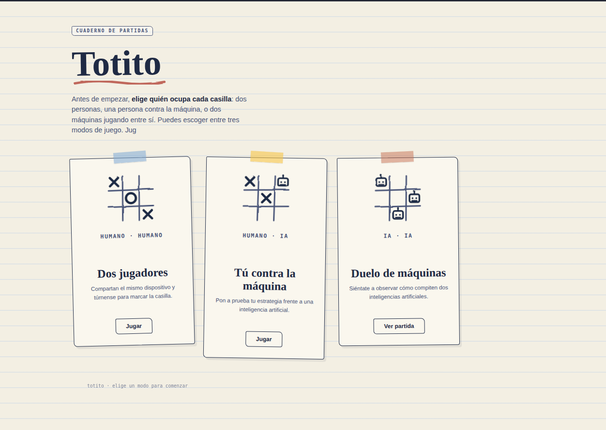

# Totito React

## Descripción general

Totito React es una versión moderna del clásico juego de tres en raya, desarrollada con React y Vite. El proyecto permite disfrutar del juego en tres modalidades principales:

- Humano vs Humano
- Humano vs IA
- IA vs IA

La interfaz está diseñada con un estilo visual tipo cuaderno, con una paleta cálida y una presentación artesanal que se integra con la temática del juego. Además de la lógica tradicional del Totito, la aplicación incluye la posibilidad de reiniciar la partida en cualquier momento y volver a las opciones de juego desde una acción global en la parte superior izquierda de la pantalla.

El objetivo principal del proyecto es ofrecer una experiencia clara, competitiva y fácil de jugar, incorporando inteligencia artificial para ampliar la dinámica del juego más allá del modo local.

## Captura de pantalla



## Tecnologías implementadas

- React 19
- Vite
- JavaScript
- CSS personalizado
- Context API
- useReducer
- OpenAI API

## Cómo funciona

La aplicación maneja el estado global del juego con React Context y un reducer. Esto permite mantener sincronizados el tablero, el turno actual, la modalidad seleccionada y el estado de la partida.

### Modos disponibles

1. Humano vs Humano
   - Dos jugadores interactúan con el mismo tablero.
   - El sistema alterna turns y valida si hubo ganador o empate.

2. Humano vs IA
   - El usuario juega contra una inteligencia artificial.
   - Cuando es el turno de la IA, la app envia el tablero actual a OpenAI para que decida la siguiente jugada.

3. IA vs IA
   - Ambas acciones son gestionadas por la IA de manera automática.
   - La aplicación ejecuta una secuencia de movimientos sin intervención del usuario.

### Integración con OpenAI

La parte de IA se implementa utilizando la API de OpenAI para analizar el estado del tablero y responder con una posición disponible válida. La lógica del prompt está orientada a priorizar:

- ganar si existe una jugada inmediata,
- bloquear al rival cuando pueda ganar,
- tomar el centro si está libre,
- usar esquinas según corresponda,
- y en último caso llenar cualquier espacio disponible.

La respuesta se espera en formato JSON, por ejemplo:

```json
{"posicion": 4}
```

Con esto, la IA puede decidir la próxima jugada de manera estratégica dentro del juego.

## Requisitos previos

Antes de iniciar el proyecto, asegúrate de tener instalado:

- Node.js 18 o superior
- npm

## Instalación

1. Clona el repositorio:

```bash
git clone <url-del-repositorio>
cd Totito_React
```

2. Instala las dependencias:

```bash
npm install
```

3. Configura tu clave de OpenAI:

Crea un archivo `.env` en la raíz del proyecto con el siguiente contenido:

```bash
VITE_OPEN_API_KEY=tu_clave_aqui
```

4. Ejecuta la aplicación en modo desarrollo:

```bash
npm run dev
```

5. Abre la URL indicada en la terminal, normalmente:

```bash
http://localhost:5173
```

## Scripts disponibles

```bash
npm run dev
npm run build
npm run preview
```

## Estructura principal del proyecto

```text
src/
├── App.jsx
├── Context/
├── components/
├── reducers/
├── types/
├── main.jsx
└── assets/
```

## Licencia

Este proyecto está destinado a fines educativos y de demostración.

## Nota final

Totito React combina la simplicidad del juego clásico con una interfaz moderna, reglas claras y una capa de inteligencia artificial que enriquece la experiencia de juego en los modos contra la máquina o entre dos IAs.
